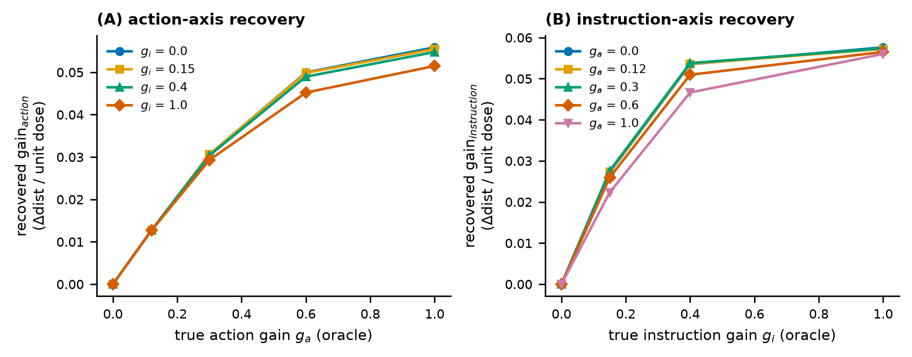
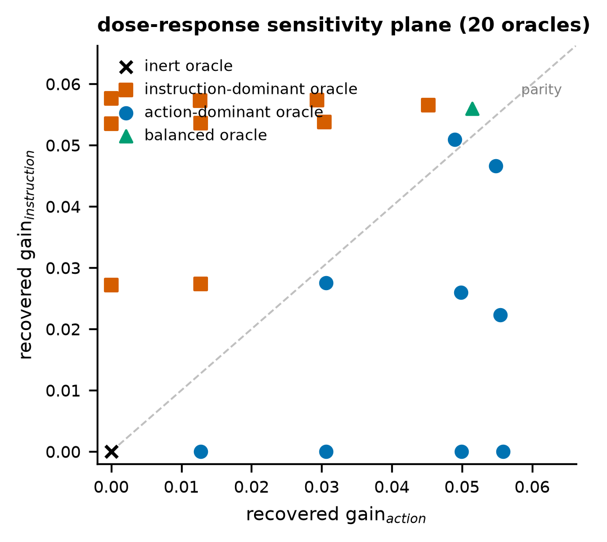
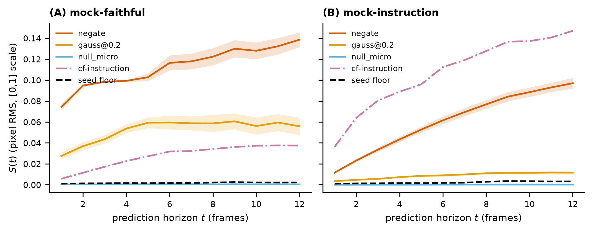
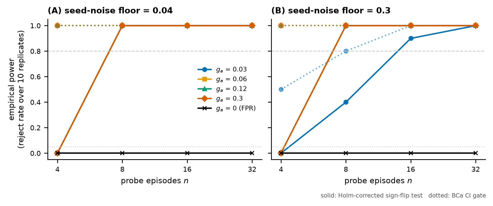

# The Action-Faithfulness Probe: A Training-Free, Judge-Free, Horizon-Resolved Benchmark for the Causal Conditioning Gap in Video World Models

**Status: methods complete and validated on synthetic oracles; real-checkpoint results pending GPU access (see Section 5, Handoff).**
**Target venues: NeurIPS / ICLR Datasets & Benchmarks track; MLSys (harness); robot-learning / world-models workshops as fallback.**

---

## Abstract

Video world models for robotics are trained to predict future frames given an initial observation, a task instruction, and an action signal. Because the training loss is dominated by pixel reconstruction of successful demonstrations, a model can minimize loss by learning the shortcut *instruction → demonstrated outcome* while treating the per-step action as ignorable side information — producing plausible task completions that are not faithful to the specific low-level actions it was given. We call the difference between responding to the instruction and responding to the action the **causal conditioning gap**; a world model with this gap is useless for planning, since every downstream planner would optimize a function that is flat in the variable it controls. We present the **Action-Faithfulness Probe (AFP)**, a benchmark that measures this gap on any released action-conditioned checkpoint in an afternoon on one GPU, with no training, no VLM or human judges, and no internal model access. AFP feeds a checkpoint paired rollouts under original and perturbed actions (common random numbers), producing (i) a horizon-resolved **Action-Sensitivity Curve** `S(t)`; (ii) a within-model **action-vs-instruction dose-response plane** whose axes are per-channel gains in common units (divergence per unit normalized dose), sidestepping the incommensurability of action-space and language-space edit magnitudes; and (iii) a pre-registered gate battery — reactivity, null-floor, monotonicity, and separation — decided by BCa bootstrap confidence bounds and Holm-corrected paired sign-flip permutation tests. On a 5×4 grid of 20 synthetic oracle world models with *known* action gain \(g_a\) and instruction gain \(g_i\), AFP recovers the action-axis ordering perfectly (Spearman ρ = 1.00 at every fixed \(g_i\); pooled ρ = .985), recovers the instruction axis equally (ρ = 1.00; pooled ρ = .977), classifies 17/20 dominance verdicts correctly with all 3 errors in the conservative direction, and flags the doubly-inert oracle. A power study (400 replicated scoring runs) shows the probe detects an action gain as small as 3% of full scale with power ≥ 0.9 from **16 probe episodes**, at a per-model cost of ≈ 12 A100-hours (≈ $15). In place of a results section, Section 5 is a handoff: the exact resources, commands, decision gates, and budget (≈ $250–450 total) required to produce the real-checkpoint leaderboard on NVIDIA Cosmos-Predict2-2B-Sample-Action-Conditioned, IRASim, and Ctrl-World.

---

## 1 Introduction

World models — models that predict how an environment evolves under an agent's actions — have become a central abstraction in robot learning. Released video world models now produce visually striking futures conditioned on a start frame, a language instruction, and a per-step action trajectory. The implicit promise is that such models can serve as learned simulators: a planner proposes candidate actions, the world model predicts their consequences, and the planner selects the best. That promise rests on a property that visual quality does not certify and that current evaluations rarely test directly: **the predicted future must actually depend on the action input**.

There is a specific mechanism by which this property fails. Training corpora are dominated by *successful* demonstrations, so the pixel-reconstruction loss can be minimized by inferring the demonstrated outcome from the instruction while ignoring the fine-grained action channel. The resulting model repaints task success regardless of what the actions say. This failure is now independently documented from several directions: MiraBench finds "optimism bias" — predicting success under failure-inducing actions — to be *pervasive* across 12 model configurations and finds visual fidelity a poor proxy for action fidelity [MiraBench 2026]; dWorldEval shows that baselines' transition-space error roughly doubles on failure trajectories, the signature of hallucinating success [dWorldEval 2026]; and a recent position paper argues that "counterfactual action fidelity" is the first genuinely interventional requirement (its level L4) separating a decision-relevant world model from a future-video prior [Position 2026]. The axis, in other words, is validated. What is missing is a *cheap, general instrument* for measuring it.

Existing measurements are either judge-dependent (MiraBench needs VLM judges validated against a 16,704-judgment human corpus, so extending it to a new checkpoint is a months-scale annotation effort), architecture-dependent (latent-space sensitivity probes need internal access and are not training-free), ground-truth-referenced (World-in-World's controllability score `1 − LPIPS(GT, pred)` requires the true future under the same actions, unavailable for counterfactual actions by construction), or single-number (no horizon resolution, no within-model action-vs-instruction contrast). Section 2 makes this precise.

**Hypotheses.** Following the convention of stating falsifiable predictions before measurement, the real-checkpoint study is pre-registered around three hypotheses:

- **H1 (metric validity — tested in this paper).** If a world model's future is causally driven by its action input with gain \(g_a\), then a paired-seed, observation-space divergence probe recovers the ordering of \(g_a\) across models (Spearman ρ ≥ 0.7), holds nulls at the stochastic floor, and detects inert conditioning — *without* any per-model tuning. *Falsifier:* rank violations or null-floor breaches on oracles with known gain.
- **H2 (the causal conditioning gap exists in released checkpoints — pending GPU).** At least one released action-conditioned world model exhibits instruction-dominant gains (gain_instruction > gain_action) or an action gain statistically indistinguishable from its seed floor. *Falsifier:* all tested checkpoints show action-dominant, floor-clearing gains — itself a publishable positive certification.
- **H3 (horizon structure — pending GPU).** Action sensitivity is not constant in the prediction horizon: models differ in *where* faithfulness decays (early wiring failure vs. late decoherence). *Falsifier:* flat, featureless `S(t)` across all models and perturbations.

**Contributions.**

1. **A metric suite** (Section 3): the horizon-resolved Action-Sensitivity Curve `S(t)`; a dose-response formulation of the within-model action-vs-instruction comparison that avoids the cross-channel magnitude incommensurability which invalidates naive sensitivity ratios; an embodiment-agnostic null hierarchy (identity, sub-quantization micro-edit, seed floor) replacing invalid placebos; and a pre-registered inferential protocol (BCa bootstrap gate bounds; one-tailed paired sign-flip permutation tests, Holm-corrected; paired Cohen's d effect sizes).
2. **A pip-installable harness** (`afp`, 123 CPU-only tests) with a frozen adapter interface: any checkpoint implementing `rollout(o0, instruction, actions, seed) → frames` gets a scorecard, leaderboard entry, and figure set with one command. Guarded adapters for the three target checkpoints are written and tested up to the GPU boundary.
3. **Synthetic-oracle validation of H1** (Section 4): perfect rank recovery on both channels across 20 oracles with known gains, a characterization of the probe's one systematic bias (conservative attenuation under channel competition), and an empirical power analysis that fixes the probe-set size and GPU budget for the real study.
4. **A handoff protocol** (Section 5): the exact commands, data, licenses, decision gates, and ≈ $250–450 budget needed to complete the real-checkpoint study, pre-registered so that the remaining work is execution, not design.

We do not claim to have discovered the causal conditioning gap — MiraBench and the position paper establish the axis. The contribution is the *conjunction* no prior work holds: training-free ∧ judge-free ∧ observation-space ∧ horizon-resolved ∧ within-model two-channel ∧ single-GPU-afternoon.

---

## 2 Related Work

**Judge-based action-reliability benchmarks.** MiraBench (arXiv:2605.29360; verified) is the closest prior work: a three-level hierarchy (Physics Adherence, Action-Following Fidelity, Optimism-Bias Detection) built on a 16k-judgment human corpus supervising InternVL3-78B judges, evaluated over 12 model configurations. Its Level 3 is, in substance, the causal conditioning gap. AFP differs in being judge-free (runnable on a new checkpoint in an afternoon, no annotation campaign), horizon-resolved (a curve, not a level score), and within-model two-channel (a controlled Δa-vs-Δl contrast inside one checkpoint, rather than comparing vector- vs text-conditioned models across a suite). The two are complementary: AFP is the cheap screen you run before paying for a MiraBench-grade evaluation, and correlating AFP scores with MiraBench's on shared models (both cover Cosmos-Predict2) is a planned validation (Section 5.4).

**Transition-space metrics.** dWorldEval (arXiv:2604.22152; verified, including the Δ-LPIPS definition and the expert/failure numbers 0.315/0.352 vs. WorldGym's 0.347/0.650) shows transition-space comparisons separate models that absolute-frame metrics collapse. We adopt the idea as an *exploratory* secondary metric only: difference images are out-of-distribution for LPIPS/DreamSim backbones (we remap signed diffs to [0,1] and default the transition curve to pixel-L2), dWorldEval has no public code to validate against, and its metric is ground-truth-referenced while ours is counterfactual.

**Structural/algebraic action faithfulness (concurrent).** *World Models as Group Actions* (arXiv:2605.24578; verified, under review) formalizes action faithfulness via group identity/inverse/composition consistency, uses the zero action as an invariance reference, and treats stochastic-rollout divergence as a robustness floor — independently arriving at two of our calibration choices. It is a *training-time regularization* method with latent-space metrics; AFP is a black-box evaluation instrument requiring no gradients, no latents, and no ground truth. We cite it as convergent evidence for the identity-null and seed-floor design.

**Position and protocol work.** The decision-making-centric position paper (arXiv:2606.15032; verified) proposes an L0–L7 evaluation ladder and names "counterfactual action fidelity" (L4) as the minimal interventional test, but implements nothing. AFP is a concrete, lightweight L4 instantiation. World-in-World (ICLR 2026 Oral) measures controllability as agreement with ground truth under the *same* actions — single-channel and GT-referenced, hence unable to probe counterfactual actions. iWorld-Bench and WBench report trajectory accuracy against ground truth. The UWM counterfactual probe (arXiv:2605.25313) established that prediction quality degrades monotonically with action-perturbation severity — the validity signal our monotonicity gate demands — but requires internal access. nwm (CVPR 2025) rolls out navigation world models under varied inputs across horizons but does not contrast action against language.

**Property table.** No prior work holds all six:

| Property | dWorldEval | Group-Actions | nwm | UWM-CF | MiraBench | **AFP** |
|---|---|---|---|---|---|---|
| Training-free on any released ckpt | partial | no | yes (nav) | no | no | **yes** |
| Judge-free | yes | yes | yes | yes | no | **yes** |
| Observation-space (no internals) | yes | no | yes | no | yes | **yes** |
| No ground-truth future needed | no | no | yes | no | yes | **yes** |
| Horizon-resolved curve | no | no | partial | no | no | **yes** |
| Within-model action-vs-instruction | no | no | no | no | no | **yes** |

**Methodological ancestry.** The oracle-validation design follows the sanity-check methodology of Adebayo et al. (NeurIPS 2018): probes are validated on models with known ground truth but never tuned on them. The invalid-placebo analysis of our earlier null follows Veitch et al. (2021) on counterfactual invariance. The dose-response formulation borrows from standardized indirect effects in causal mediation (Preacher & Kelley 2011) and perturbation dose-response methods. Statistical gates follow Dror et al. (ACL 2018) and Bestgen (LREC 2022): BCa intervals, paired permutation tests, Holm correction, decisions on CI bounds rather than point estimates.

---

## 3 Method

### 3.1 Setup

A world model under test is a black box \(M: (o_0, \ell, a_{1:T}) \mapsto \hat{o}_{1:T}\) mapping a start frame, an instruction, and a per-step action chunk (for the Bridge-domain primary: \(T{=}12\), 7-DoF actions \((dx,dy,dz,d\text{roll},d\text{pitch},d\text{yaw},\text{gripper})\)) to predicted frames. AFP controls the inputs and observes only frames. All sampling uses **common random numbers**: the base rollout and every perturbed rollout share one seed, so their difference isolates the input edit; a separate set of ≥ 5 seeds on identical inputs measures the model's stochastic floor.

### 3.2 Action-Sensitivity Curve

For a perturbation operator \(P\) and per-frame distance \(D\) (primary: pixel-RMS; optional: LPIPS, DreamSim),

\[ S_P(t) = D\big( M(o_0, \ell, a)[t],\; M(o_0, \ell, P(a))[t] \big), \qquad t = 1..T. \]

A faithful model's \(S(t)\) rises with \(t\) (action edits compound) and with the physical magnitude of \(P\). The empirical **seed floor** \(\varepsilon(t)\) — mean pairwise distance across same-input, different-seed rollouts — is the denominator for every claim, because GPU sampling is not bit-exact and diffusion models have intrinsic stochasticity. A transition-space variant \(S^\Delta(t)\) comparing consecutive-frame difference images (dWorldEval-inspired) is computed but flagged exploratory; signed diffs are remapped to [0,1] before any perceptual backend to respect input contracts.

### 3.3 Perturbation operators

Action channel, ordered by physical severity: `identity` (rank 0) < `null_micro` (rank 0; sub-quantization Gaussian on motion dims — below one action-token bin, so any faithful model must be invariant) < `null_shuffle` (rank 0; *mock-only* illustrative null — its "inert dims" are physically active on a real robot, an invalid placebo off the mock, per Veitch et al.) < `gauss(σ)` ladder (σ ∈ {0.05, 0.1, 0.2, 0.4}) < `scale` < `reverse` < `negate` ≈ `swap` (another episode's coherent actions) < `random_action`. Instruction channel: `paraphrase` (semantics-preserving; the channel floor) and an interpolation ladder from the true instruction embedding toward a matched `counterfactual` embedding at fractions {0.25, 0.5, 0.75, 1.0} (the channel dose ladder). All operators are pure functions with tagged magnitudes.

### 3.4 The dose-response sensitivity plane

A naive ratio \(S_{action}/S_{instruction}\) at fixed operating points is invalid: action-space and language-space edits share no magnitude unit, so any fixed pair of operating points encodes an arbitrary severity choice ("violent edit vs. gentle paraphrase"). AFP instead sweeps each channel's *dose* on its own ladder and fits, at each horizon \(t\), the least-squares slope of divergence-above-floor against dose *normalized to [0,1] within the channel*:

\[ \text{gain}_c(t) = \text{slope}_{d \in \text{ladder}_c}\Big( \big[S_c(t; d) - \text{floor}_c(t)\big]_+ \;\text{vs.}\; \tilde{d} \Big), \qquad c \in \{\text{action}, \text{instruction}\}, \]

with the action floor = seed floor and the instruction floor = paraphrase divergence. Both gains carry the same units (Δ-distance per unit normalized dose) and are directly comparable; the headline readout is the plane \((\text{gain}_a, \text{gain}_i)\) plus the per-horizon dominance share \(\text{gain}_a(t)/(\text{gain}_a(t)+\text{gain}_i(t))\). Verdicts (action-faithful / instruction-driven / balanced / inert) are dominance calls with a fixed 0.10 share margin and an absolute inert threshold. **De-circularization:** ladders, floors, the slope estimator, and thresholds are fixed a priori; the synthetic oracles of Section 4 validate the protocol but nothing is tuned on them.

### 3.5 Statistical protocol

Per model, AFP reports: (i) 95% **BCa bootstrap** intervals (Efron 1987) on final-horizon divergences — BCa rather than percentile because per-episode divergence means are small-n and right-skewed; (ii) a family of three one-tailed **paired sign-flip permutation tests** (10,000 resamples, direction pre-registered as "greater"), paired per episode against that episode's own seed floor: reactivity (`negate` > floor), separation (severe edit > 3× floor), and instruction reactivity (counterfactual > floor); (iii) **Holm-Bonferroni** correction across the family; (iv) paired **Cohen's d** effect sizes. The Stage-2 GO/KILL gates fire on CI lower bounds and adjusted p-values, never point estimates: **reactivity** (BCa lower bound of \(S_{negate}(T)\) > floor), **null-floor** (mean \(S_{null\_micro}\) < floor + 1 SD), **monotonicity** (Spearman ρ of severity rank vs. mean divergence ≥ 0.7), **separation** (BCa lower bound ≥ 3× floor). A discreteness constraint worth noting: a sign-flip test on \(n\) paired episodes cannot produce \(p < 2^{-n}\), so the Holm-corrected family (m = 3) requires \(n \geq 6\) episodes to be able to reject at α = .05 at all; we use \(n \geq 16\) (Section 4.2).

### 3.6 Harness

`afp` is a pip-installable package (numpy-only core; torch optional for perceptual backends): `perturb.py` (operators), `metrics.py` (curves, floors, dose-response, BCa, permutation, Holm), `score.py` (orchestration → JSON scorecards), `report.py` (leaderboard, plane, figures), `cli.py` (`afp gen-data | run | backends`), and `adapters/` — a mock suite with tunable ground-truth gains plus guarded subprocess adapters for Cosmos-Predict2-SAC, IRASim, and Ctrl-World that import without torch, report `available() = False` until weights/env-vars exist, and raise their full setup instructions otherwise. 123 tests run CPU-only in < 3 s. Every number is bit-reproducible (process-stable hashing, seeded everything).

---

## 4 Synthetic-Oracle Validation (H1)

Real checkpoints have unknown ground truth, so metric validity must be established where ground truth is known — the *Sanity Checks* methodology. The mock world model renders an end-effector blob whose velocity is \(g_a \cdot \text{(commanded } dx,dy) + g_i \cdot \text{(instruction-embedding drift)} + \text{seeded jitter}\): \(g_a\) and \(g_i\) are the *true* channel gains, set by construction.

### 4.1 Experiment 1: oracle recovery

**Design.** 20 oracles on the grid \(g_a \in \{0, .12, .3, .6, 1.0\} \times g_i \in \{0, .15, .4, 1.0\}\), each scored with the identical pre-registered protocol (16 episodes, 5 seeds, pixel-RMS distance; ≈ 10 minutes total on a laptop CPU). Reproduce: `python experiments/exp1_oracle_recovery.py`.

**Results.**
- **H1a (action-axis recovery): confirmed.** Recovered gain_action is perfectly rank-correlated with true \(g_a\) at every fixed \(g_i\): ρ = 1.00 (n = 5 per stratum, all four strata); pooled across the grid, ρ(18) = .985. Recovery is monotone but concave (saturation of the bounded pixel metric at large gains) — ranks, not linear calibration, are the supported readout, which is what the leaderboard uses.
- **H1b (instruction-axis recovery): confirmed.** ρ = 1.00 at every fixed \(g_a\) (five strata); pooled ρ(18) = .977.
- **Cross-channel leakage: small, systematic, conservative.** Recovered gain_action attenuates slightly as the *competing* channel grows (at \(g_a = 1.0\): 0.0559 → 0.0515 across \(g_i\): 0 → 1, a −7.9% compression; rank order across \(g_i\) strata preserved). The mechanism is physical, not metrical: both channels move the same bounded pixels, so a strong competing drift subtracts headroom. Consequence: dominance verdicts err toward "balanced," never toward inverting the dominant channel.
- **Verdicts: 17/20 correct; all 3 errors conservative.** Mistakes are exactly the near-margin action-dominant cells (\(g_a{=}.3, g_i{=}.15\); \(g_a{=}.6, g_i{=}.4\); \(g_a{=}1.0, g_i{=}.4\)) called "balanced." No inversion errors; the doubly-inert oracle (\(g_a{=}g_i{=}0\)) is correctly flagged **inert** (H3-inert check).
- **Gates: 16/16 action-sensitive oracles pass all four gates.** Representative model (\(g_a{=}1.0, g_i{=}.15\)): reactivity \(p_{\text{Holm}} = .0003\), paired d = 3.68; separation \(p_{\text{Holm}} = .0003\), d = 3.65, separation ratio 58×; instruction reactivity \(p_{\text{Holm}} = .0003\), d = 1.25; monotonicity ρ = .93.


*Figure 1. Oracle recovery. (A) Recovered action gain vs. true \(g_a\), one line per fixed \(g_i\); (B) the instruction axis. Perfect rank recovery on both axes; concave saturation at large gains.*


*Figure 2. The recovered dose-response plane for all 20 oracles, colored by ground-truth dominant channel. Action-dominant oracles (blue) fall below the parity line, instruction-dominant (orange) above, the inert oracle at the origin — the geometry the real leaderboard will be read on.*


*Figure 4. Exemplar horizon-resolved curves (mean ± SEM over 24 episodes). The faithful mock (A) separates `negate` far above the counterfactual instruction; the instruction-driven mock (B) inverts the ordering — while `null_micro` hugs the seed floor in both, as a valid null must.*

### 4.2 Experiment 2: power and cost

**Design.** For each cell of {true \(g_a\) ∈ {0, .03, .06, .12, .3}} × {seed-noise floor ∈ {0.04, 0.3}} × {n_episodes ∈ {4, 8, 16, 32}}, 10 independent replicates of the full scoring protocol (400 runs); we record the rejection rate of the Holm-corrected reactivity test and of the BCa CI gate. \(g_a = 0\) rows estimate the false-positive rate. Reproduce: `python experiments/exp2_power_analysis.py` (≈ 3.5 min CPU).

**Results.**
- **False positives: 0/80 replicates** across both deciders, all n, both noise levels (conservative; nominal α = .05).
- **Low-noise regime** (floor 0.04): the permutation test reaches power 1.0 by **n = 8** even for \(g_a = .03\) (3% of full gain); n = 4 is structurally powerless for the permutation family (the \(2^{-n}\) discreteness bound of Section 3.5), while the CI gate already fires.
- **High-noise regime** (floor 0.3, ≈ 8× the mock default — a pessimistic stand-in for a noisy diffusion sampler): \(g_a = .03\) needs **n = 16 for power 0.9** and n = 32 for 1.0; \(g_a \geq .06\) has power 1.0 from n = 8.
- **Recommended operating point: n = 16 episodes** (n = 32 if the measured Cosmos seed floor is high), 5 seeds, the full 23-rollouts-per-episode protocol.
- **Cost model** (per real model at 120 s/rollout on A100 @ $1.19/h): n = 16 → 368 rollouts ≈ 12.3 A100-h ≈ **$15**; n = 32 → $29; n = 50 → $46. Three checkpoints at n = 32 ≈ **$88 of sweep compute** — an order of magnitude below the design document's conservative envelope, because common-random-number pairing needs the multi-seed set only for the floor, not per perturbation.


*Figure 3. Empirical power of the reactivity deciders vs. probe-set size, at a low (A) and pessimistically high (B) stochastic floor. Solid: Holm-corrected sign-flip test; dotted: BCa CI gate; black ×: false-positive rate at \(g_a = 0\). Dashed line: 0.8 power.*

**What Experiment 2 pins down for the real study:** the probe-set size, the seeds count, the expected sensitivity limit (a channel gain ≈ 3% of the severe-edit scale is detectable), and the budget — all fixed *before* touching the checkpoint, closing the garden-of-forking-paths.

---

## 5 Handoff: Completing the Real-Checkpoint Study

This section replaces Results. Everything below is specified so that the remaining work is execution. **Items marked ► are what I need from you.**

### 5.1 What you must provide

| # | Item | Details | Cost / effort |
|---|---|---|---|
| ► 1 | **GPU access** | One **A100 80 GB** (or 40 GB + offload flags; H100 works and is ~1.5× faster per rollout). RunPod/Lambda ≈ $1.19–2.00/h. A department GPU makes compute free. | ≈ $250–450 total (5.6) |
| ► 2 | **Hugging Face license acceptance** | Accept the NVIDIA license for `nvidia/Cosmos-Predict2-2B-Sample-Action-Conditioned` (gated), then `hf download`. Needs your HF account; I cannot accept licenses for you. | 10 min + ~10 GB download |
| ► 3 | **Bridge data** | `bridge_train_data.tar.gz` (~31 GB) from IRASim's public bucket → `<cosmos-repo>/datasets/`. Known path mismatch: examples expect `datasets/bridge/annotation/test/…` (singular) while the tarball ships `annotations/` — symlink at setup. | ~1 h download |
| ► 4 | **Spread-model weights** | IRASim (Bridge-domain, safest second model; large downloads ~95–129 GB) and Ctrl-World (DROID, ~8 GB). Both public. | downloads + license clicks |
| ► 5 | **(Optional, Stage 4)** MiraBench artifacts | Their per-model scores for the correlation validation (public release pending; contact authors if not). | email |

### 5.2 Runbook (pre-registered; do not reorder)

**Stage 0 — first rollout (gate: frames come out; ~1 day).**
```bash
# on the GPU box
git clone https://github.com/nvidia-cosmos/cosmos-predict2 && cd cosmos-predict2
# install per repo docs (Docker image recommended); download ckpt + Bridge data (5.1)
python examples/video2world_action.py --model_size 2B \
    --dit_path <ckpt> \
    --input_video datasets/bridge/videos/test/13/rgb.mp4 \
    --input_annotation datasets/bridge/annotation/test/13.json \
    --num_conditional_frames 1 --save_path out.mp4 --guidance 0 --seed 0 \
    --disable_guardrail --disable_prompt_refiner
```
Pin: one GPU model, bf16 (only supported precision), `--guidance 0`, fixed denoising steps, `CUBLAS_WORKSPACE_CONFIG=:4096:8`, `torch.backends.cudnn.deterministic`. *KILL/PIVOT:* blocked > 1 week on access/license → promote IRASim to primary.

**Stage 1 — reactivity sanity (gate: the model reads `a` at all; ~half a day).**
```bash
export AFP_COSMOS_REPO=... AFP_COSMOS_CKPT=... AFP_COSMOS_INPUT_VIDEO=...
cd action-faithfulness-probe && pip install -e ".[dev,lpips]"
afp run --models cosmos-sac --distance pixel_l2 --data data_bridge/ --out results_stage1/ --seeds 5 --n 4
```
(First build `data_bridge/`: an `episodes.jsonl` from ~16–32 held-out Bridge test clips — start frame, instruction, 7-DoF chunk from the annotation JSONs; `afp/adapters/_action_io.py` has the converters. The paraphrase/counterfactual instruction sets are written by hand once, ~1 h, human-checked.) *Gate:* `S_identity(t)` < measured floor ε; `S_negate(t)` BCa-clears the floor. *KILL/PIVOT:* negate ≈ floor at every horizon → checkpoint conditions on `a` only cosmetically → swap primary (that finding is itself reportable, after ruling out wiring bugs).

**Stage 2 — metric validity on the real model (~2–3 days incl. sweep).** Full protocol at n = 16 (escalate to 32 if the measured floor is high — Fig. 3B): the four gates of Section 3.5 with `null_micro` (never `null_shuffle`) as the null. *KILL/PIVOT:* monotonicity ρ < 0.4 after switching distance backends (pixel → LPIPS → DreamSim) and doubling seeds → the observation-space route is dead; escalate to latent probes and report the negative. Budget 2 weeks of metric engineering maximum.

**Stage 3 — the leaderboard (~2–4 weeks, the variance driver).** Bring up IRASim and Ctrl-World behind the existing adapters; resample all outputs to a common time grid (adapters expose native horizon/fps; the metrics module truncates to min-T — for cross-model curves, interpolate to seconds, not frames). Run the identical protocol; produce the plane, curves, and Holm-corrected per-model stat families. *Interesting under any of:* models occupy different plane regions (spread); all models instruction-dominant (universal-gap negative result — corroborates MiraBench with a judge-free instrument); or horizon structure (H3). *KILL/PIVOT:* single indistinct cluster and flat curves → widen the model set (Boundless, DreamDojo) and harden counterfactual instructions.

**Stage 4 — write-up (~2 weeks).** Swap this section for Results; add the MiraBench correlation on shared models if artifacts are obtainable; release the harness + leaderboard. Frame as the judge-free, horizon-resolved *complement* to MiraBench and the first lightweight implementation of the position paper's L4 test — never as having discovered the gap.

### 5.3 Budget

| Item | Estimate |
|---|---|
| Stage 0–1 dev/debug (A100) | ~20 h ≈ $25 |
| Stage 2 sweep, primary (n = 32) | ~25 h ≈ $30 |
| Stage 3 spread bring-up + sweeps (2 models) | ~80–150 h ≈ $95–180 |
| Re-runs / LPIPS+DreamSim passes / buffer | ≈ $100–200 |
| **Total** | **≈ $250–450** |

### 5.4 Publication path and risk

Calibrated (from the design document's staged tree, updated for the now-complete Stages "build + validate"): P(workshop-publishable artifact) ≈ 0.60–0.65 — the floor is high because the universal-gap *negative* result is publishable; P(main-conference strength) ≈ 0.25–0.30, requiring the spread result plus the MiraBench correlation or a downstream-planning tie-in. The two real risks are unchanged: (1) assembling ≥ 3 working action-input checkpoints (domain/resolution/horizon comparability work), and (2) the real model's seed floor being so high that even n = 32 lacks power — Fig. 3B says detection then still holds for gains ≥ 6% of scale, and "action gain indistinguishable from floor at n = 32" is itself an H2-confirming finding, provided Stage-1 wiring checks pass.

### 5.5 Pre-registration summary (freeze before GPU)

Protocol constants: n = 16 episodes (32 on high floor), seeds (0..4), σ-ladder {.05,.1,.2,.4}, instruction fracs {.25,.5,.75,1.0}, distance = pixel-RMS primary / LPIPS secondary, gates and thresholds as in Section 3.5, verdict margin 0.10, α = .05, one-tailed "greater," Holm over the 3-test family, BCa 95%. Confirmatory analyses: H2, H3 as stated in Section 1. Everything else (transition curves, DreamSim, autoregressive chaining beyond 12 frames) is labeled exploratory.

---

## 6 Discussion and Limitations

**What the synthetic validation does and does not establish.** Experiments 1–2 establish that the *instrument* is sound: it recovers known causal structure without per-model tuning, holds its nulls, and its error mode is conservative attenuation rather than inversion. They cannot establish anything about real checkpoints — the mock's rendering is trivially smooth, its "instruction reading" is a linear drift, and its stochasticity is well-behaved Gaussian jitter. The high-noise power cells are a stand-in for, not a measurement of, a diffusion sampler's floor. This is exactly why Section 5 exists.

**Known instrument limitations.** (i) *Attenuation under channel competition* (−8% at worst on the grid): dominance verdicts near the margin should be reported with the raw gains and CIs, and the "balanced" verdict read as "no dominant channel at margin 0.10," not as a point claim. (ii) *Bounded-metric saturation*: gains are ordinal across models, not ratio-scaled; the leaderboard ranks, the plane visualizes, and no claim should rest on gain arithmetic. (iii) *Instruction channel realism*: real checkpoints consume text, not our embeddings; the interpolation ladder becomes a set of graded rewordings (paraphrase → partial counterfactual → full counterfactual), whose "dose" is ordinal — the dose-response slope then needs the ordinal-dose variant (rank-based), which the harness supports via custom ladders. (iv) *Short horizon*: the primary checkpoint emits 12 frames (~3 s); long-horizon claims require autoregressive chaining and are out of scope for the base result. (v) *Single-embodiment primary*: Bridge tabletop; cross-domain comparability in Stage 3 depends on time-grid resampling and is the leaderboard's weakest joint.

**Relation to concurrent work, honestly.** If *World Models as Group Actions* is accepted first, the identity-null and stochastic-floor ideas will read as theirs; our surviving wedge is the black-box, no-ground-truth, two-channel, horizon-resolved *instrument* and the released-checkpoint findings. If MiraBench's camera-ready lands with a cheap screening mode, the "afternoon-scale" wedge narrows to judge-freeness and the within-model contrast. Both papers should be cited generously; the framing that survives all outcomes is *the cheap L4 screen you run before the expensive evaluation*.

---

## 7 Reproducibility

All code, tests, data generators, experiment scripts, and figures: `action-faithfulness-probe/` (pip-installable; 123 CPU-only tests, `python -m pytest`). Experiments: `experiments/exp1_oracle_recovery.py`, `experiments/exp2_power_analysis.py`, `experiments/make_figures.py`; outputs under `results/synthetic/` and `results/figures/`. The committed demo (`afp run --models mock`) reproduces the three-mock leaderboard bit-exactly. Full design rationale, four-revision changelog, and verified-citation ledger: `DESIGN.md`.

## References

- MiraBench: Evaluating Action-Conditioned Reliability in Robotic World Models. arXiv:2605.29360, 2026. *(verified 2026-07-10: abstract, 3 levels, 16k judgments, 12 configs, headline findings)*
- dWorldEval: Scalable Robotic Policy Evaluation via Discrete Diffusion World Model. arXiv:2604.22152, 2026. *(verified: Δ-LPIPS definition, expert/failure 0.315/0.352, WorldGym 0.347/0.650, r ≈ 0.9)*
- World Models as Group Actions. arXiv:2605.24578, 2026, under review. *(verified: identity/inverse/composition, GAC/GAR metrics)*
- How Should World Models Be Evaluated for Embodied Decision-Making? A Decision-Making-Centric Position. arXiv:2606.15032, 2026. *(verified: L0–L7 ladder, L4 counterfactual action fidelity)*
- World-in-World: World Models in a Closed-Loop World. arXiv:2510.18135, ICLR 2026 Oral.
- Unitary World Models (UWM) counterfactual probe. arXiv:2605.25313, 2026.
- nwm: Navigation World Models. Facebook Research, CVPR 2025.
- Hou et al. World Models for Robot Learning: A Comprehensive Survey. arXiv:2605.00080.
- NVIDIA Cosmos-Predict2-2B-Sample-Action-Conditioned. HF: `nvidia/Cosmos-Predict2-2B-Sample-Action-Conditioned`; repo: `nvidia-cosmos/cosmos-predict2`.
- IRASim: Learning Interactive Real-Robot Action Simulators. arXiv:2406.14540, ICCV 2025.
- Adebayo et al. Sanity Checks for Saliency Maps. NeurIPS 2018.
- Veitch et al. Counterfactual Invariance to Spurious Correlations. arXiv:2106.00545, 2021.
- Zhang et al. Emergence of Reproducibility and Consistency in Diffusion Models. arXiv:2310.05264, ICLR 2024.
- Dror et al. The Hitchhiker's Guide to Testing Statistical Significance in NLP. ACL 2018.
- Bestgen. Please, Don't Forget the Difference and the Confidence Interval when Seeking the State of the Art. LREC 2022.
- Efron. Better Bootstrap Confidence Intervals. JASA 1987.
- Preacher & Kelley. Effect Size Measures for Mediation Models. Psychological Methods 2011.
- Ho & Salimans. Classifier-Free Diffusion Guidance. 2022.
- Zhang et al. The Unreasonable Effectiveness of Deep Features as a Perceptual Metric (LPIPS). CVPR 2018.

*Caveat ledger (carried from DESIGN.md): "AGRA / Matched Sensitivity Ratio" remains unverified and is not cited above; the residual-image LPIPS failure claim is reasoned inference from the input contract, not a measured result; re-verify all 2026 arXiv venue statuses at submission time.*
