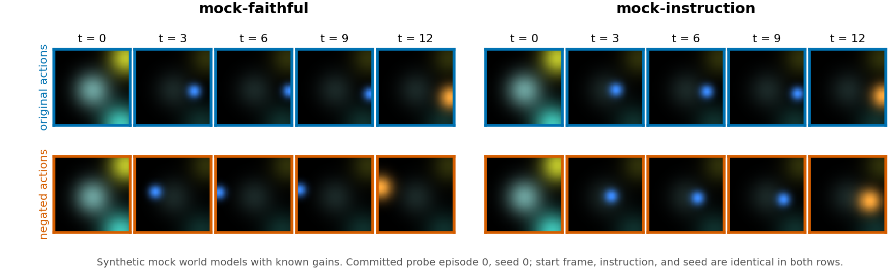

# Action Faithfulness in Robot Video World Models

This study investigates whether **action-conditioned video world models for robotics** respond to the actions they are given. Their training data is dominated by successful demonstrations, so a model can lower its reconstruction loss by predicting the outcome the instruction implies and treating the per-step actions as optional. A model that does this produces plausible futures but cannot support planning, because its predictions barely change with the variable a planner controls. The paper draft calls this the causal conditioning gap.

The main artifact is the **[Action-Faithfulness Probe](action-faithfulness-probe/) (AFP)**, a Python harness that measures the gap on a black-box checkpoint. It runs paired rollouts with the same start frame and seed, perturbs either the action chunk or the instruction, and compares how strongly each channel moves the predicted frames over the rollout horizon. The image above shows one synthetic episode: negating the actions reverses the trajectory of the action-faithful mock, but barely changes the instruction-driven mock.

## Status

The harness, metrics, and statistical tests are implemented, and the probe has been validated on synthetic mock world models whose action and instruction gains are known. No released checkpoint has been scored. Adapters for NVIDIA Cosmos-Predict2-2B-Sample-Action-Conditioned, IRASim, and Ctrl-World are written and tested up to the point where they need GPU weights, licensed model downloads, and the Bridge dataset.

On a grid of 20 synthetic oracles, the probe ranked models by their true action gain with Spearman ρ = 1.00 at each fixed instruction gain, and recovered the instruction axis equally well. 17 of 20 dominance verdicts were correct; the three misses were near-margin action-dominant models called `balanced`, and none was inverted. In the power study, no decider fired on any of the 80 zero-gain replicates. Under a pessimistic noise level, an action gain of 3% of full scale was detected with power 0.9 from 16 probe episodes. These are results on synthetic models only; the [probe README](action-faithfulness-probe/README.md#synthetic-validation) gives the full protocol and figures.

## Contents

| Path | What it is |
| --- | --- |
| [`action-faithfulness-probe/`](action-faithfulness-probe/) | The `afp` package: perturbation operators, metrics, scoring, CLI, adapters, experiments, committed results, and tests |
| [`action-faithfulness-probe/afp/DESIGN.md`](action-faithfulness-probe/afp/DESIGN.md) | Design document with metric definitions, staged GO/KILL gates, literature positioning, and revision history |
| [`PAPER.md`](PAPER.md) | Paper draft: hypotheses, related work, method, synthetic validation, and a handoff runbook and budget for the real-checkpoint study |
| [`PRIMER.md`](PRIMER.md) | Guided introduction to robot world-model evaluation, tied to the files in the probe |
| [`lit_review_action_faithful_wm.pdf`](lit_review_action_faithful_wm.pdf) | Literature review on action-faithful video world models |
| [`2605.00080v1.pdf`](2605.00080v1.pdf) | Hou et al., *World Model for Robot Learning: A Comprehensive Survey* (arXiv:2605.00080), kept for reference |

## Quick start

The mock demo runs on CPU with no checkpoints or downloads:

```bash
cd action-faithfulness-probe
pip install -e ".[dev]"
afp run --models mock --distance pixel_l2 --data data/ --out results/ --seeds 5
python -m pytest
```

The run scores the three committed mock models and writes a leaderboard, a sensitivity-plane summary, JSON scorecards, and curve plots under `results/`. The [probe README](action-faithfulness-probe/README.md) explains the method, the outputs, the synthetic experiments, and how to wrap a new world model.

## Next step

The remaining work is to score real checkpoints. Section 5 of [`PAPER.md`](PAPER.md) lays out the stages: a first Cosmos rollout, a reactivity check, a metric-validity sweep, then a multi-model leaderboard. For each stage it gives the commands, pass and fail gates, required downloads, and a GPU budget estimate. That budget assumes 120 seconds per rollout on an A100, which has not been measured.
